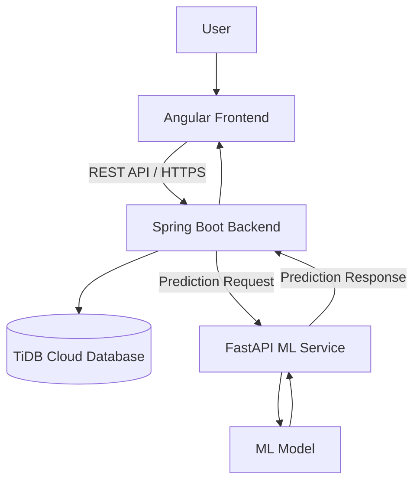

# SpendSense AI – Intelligent Expense Tracker

An AI-powered personal finance management application built using **Angular, Spring Boot, TiDB Cloud, and FastAPI**. SpendSense AI helps users manage their finances, track expenses and income, visualize spending patterns, and identify unusual transactions using machine learning.

## Overview

SpendSense AI goes beyond a traditional expense tracker by combining full-stack development with a separate machine learning service.

The application follows a layered architecture:

- **Angular:** Frontend and financial dashboard.
- **Spring Boot:** Backend business logic, REST APIs, and authentication.
- **TiDB Cloud:** Persistent financial data storage.
- **FastAPI:** Independent machine learning prediction service.

## Features

### 1. User Authentication
- User registration and login.
- JWT-based authentication.
- Password hashing using BCrypt.
- Protected API endpoints.

### 2. Expense Management
- Add and manage expenses.
- Categorize transactions.
- Track spending history.
- View expense information through the dashboard.

### 3. Income Management
- Record income transactions.
- Track income alongside expenses.
- Monitor financial activity.

### 4. Financial Dashboard
- Centralized financial overview.
- Income and expense summaries.
- Interactive financial charts using Chart.js.
- Visual representation of spending patterns.

### 5. SpendSense AI
A separate machine learning service integrated with the Spring Boot backend.

- Machine learning-based transaction anomaly detection.
- FastAPI prediction endpoints.
- Independent deployment of the ML service.
- Communication between Spring Boot and FastAPI through REST APIs.

## Technology Stack

| Layer | Technologies |
|---|---|
| Frontend | Angular 21, TypeScript, HTML, CSS |
| Visualization | Chart.js |
| Backend | Java 21, Spring Boot 3.5.6 |
| Security | Spring Security, JWT, BCrypt |
| Database | TiDB Cloud (MySQL-compatible) |
| ML Service | Python, FastAPI |
| ML Libraries | Scikit-learn, NumPy, Pandas, Joblib |
| Build Tools | Maven, npm |
| Version Control | Git, GitHub |
| Deployment | Vercel, Render, TiDB Cloud |

## System Architecture



### Architecture Explanation

1. Users interact with the Angular frontend.
2. Angular communicates with Spring Boot through REST APIs.
3. Spring Security handles authentication and authorization using JWT.
4. Spring Boot manages business logic and communicates with TiDB Cloud.
5. For machine learning predictions, Spring Boot sends requests to the independent FastAPI service.
6. The ML service processes the request and returns prediction results to the backend.

## Project Structure

```text
SpendSense/
│
├── Frontend/
│   ├── src/
│   │   ├── app/
│   │   ├── environments/
│   │   └── ...
│   ├── api/
│   ├── angular.json
│   ├── package.json
│   └── vercel.json
│
├── Backend/
│   ├── src/
│   │   ├── main/
│   │   │   ├── java/
│   │   │   └── resources/
│   └── pom.xml
│
└── spendsense-ml/
    ├── app/
    ├── models/
    ├── requirements.txt
    └── ...
```

## Local Setup and Installation

### Prerequisites

- Node.js 22+
- npm
- Java 21
- Maven 3.9+
- Python 3.10+
- MySQL-compatible database

### 1. Clone the Repository

```bash
git clone https://github.com/Jeyninn/SpendSense_Tracker.git

cd SpendSense_Tracker
```

### 2. Configure the Database

Create a database named `spendsense`:

```sql
CREATE DATABASE spendsense;
```

Configure the database connection using the backend environment variables.

### 3. Run the Spring Boot Backend

Navigate to the backend:

```bash
cd Backend
```

Configure the following environment variables:

```properties
DB_URL=jdbc:mysql://localhost:3306/spendsense
DB_USERNAME=your_username
DB_PASSWORD=your_password
JWT_SECRET=your_base64_encoded_secret
FRONTEND_URL=http://localhost:4200
SPENDSENSE_API_URL=http://localhost:8001
```

Start the backend:

```bash
mvn spring-boot:run
```

Backend URL:

```text
http://localhost:8080
```

### 4. Run the Angular Frontend

Open another terminal:

```bash
cd Frontend
npm install
npm start
```

Open the application:

```text
http://localhost:4200
```

### 5. Run the Machine Learning Service

Open another terminal:

```bash
cd spendsense-ml
```

Create a virtual environment:

```bash
python -m venv venv
```

Activate it on macOS/Linux:

```bash
source venv/bin/activate
```

Install dependencies:

```bash
pip install -r requirements.txt
```

Start the FastAPI service:

```bash
uvicorn app.main:app --reload --port 8001
```

API documentation:

```text
http://localhost:8001/docs
```

## Deployment Architecture

The application is deployed using separate services:

| Component | Platform |
|---|---|
| Angular Frontend | Vercel |
| Spring Boot Backend | Render |
| FastAPI ML Service | Render |
| Database | TiDB Cloud |

### Backend Environment Variables

| Variable | Purpose |
|---|---|
| `DB_URL` | TiDB database connection URL |
| `DB_USERNAME` | Database username |
| `DB_PASSWORD` | Database password |
| `JWT_SECRET` | JWT signing secret |
| `FRONTEND_URL` | Allowed frontend origin for CORS |
| `SPENDSENSE_API_URL` | FastAPI service URL |

**Security Note:** Never commit database credentials, JWT secrets, or other sensitive environment variables to GitHub.

## Future Improvements

- Advanced spending analytics and personalized insights.
- Budget creation and tracking.
- Monthly spending forecasts.
- Improved anomaly detection.
- Automated financial reports.
- Model evaluation and monitoring.
- More detailed financial visualizations.

## Author

**Jey Nang Gogoi**

B.Tech – Computer Science and Engineering  
National Institute of Technology Silchar

GitHub: [Jeyninn](https://github.com/Jeyninn)

---

*SpendSense AI – Making personal finance tracking smarter through full-stack engineering and machine learning.*
